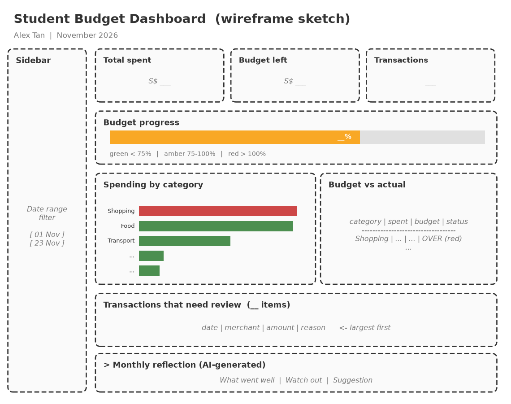

# 🛠️ Workshop guide: Build a budget dashboard with GitHub Copilot and Spec Kit

**Demo 4 · Hands-on session · about 90 minutes**

Today you won't just paste prompts. You'll **experiment** with GitHub Copilot to see how *the way you ask*, *the model you pick* and *how hard it thinks* change the result. Then you'll build a real app the way professional teams increasingly do: **spec first, code second**, using **GitHub Spec Kit**.

> 🎯 **By the end you will have:** a working budget dashboard, a written spec for it, and first-hand evidence of which Copilot techniques work best for which job.

---

## 📋 Contents
- [What you'll build](#-what-youll-build)
- [How today works](#-how-today-works)
- [Setup](#-setup-5-min)
- [Round 1: The Prompt Ladder](#-round-1-the-prompt-ladder-12-min)
- [Round 2: Model Showdown](#-round-2-model-showdown-10-min)
- [Round 3: Spec-Driven Development with Spec Kit](#-round-3-spec-driven-development-with-spec-kit-40-min)
- [Round 4: Verify and Power-ups](#-round-4-verify-and-power-ups-13-min)
- [Show and tell](#-show-and-tell-and-reflection-5-min)
- [Plan B](#-plan-b-if-spec-kit-isnt-working)
- [Troubleshooting](#-troubleshooting)
- [Cheat sheet](#-copilot-cheat-sheet)

---

## 🎯 What you'll build

A dashboard for **Alex Tan**, a fictional university student in Singapore, showing his spending for **November 2026**:

| # | Section | What it shows |
|---|---|---|
| 1 | **Current-month spending** | Total spent, budget remaining and number of transactions |
| 2 | **Budget progress** | A coloured bar showing how much of the S$1,100 budget is used |
| 3 | **Spending by category** | A chart and a budget-vs-actual table |
| 4 | **Transactions to review** | Purchases flagged as unusual by the earlier workflow |
| 5 | **Monthly reflection** | The AI-generated summary from the earlier demo |

Here's the rough idea (you'll use this sketch with Copilot later):



---

## 🗺️ How today works

| Time | Round | What you'll learn |
|---|---|---|
| 0–5 | Setup | Get your Codespace running |
| 5–17 | 🪜 **Round 1: The Prompt Ladder** | Four ways to ask Copilot, and which works best |
| 17–27 | 🥊 **Round 2: Model Showdown** | How the model and thinking effort change answers |
| 27–67 | 📐 **Round 3: Spec Kit build** | Spec-Driven Development: constitution → spec → plan → tasks → code |
| 67–80 | ⚡ **Round 4: Verify and Power-ups** | Check your numbers, then earn points with Copilot challenges |
| 80–90 | 🎤 **Show and tell** | Demo, vote and reflect |

**Points 🏆:** You'll earn points through the session. Keep track in your **scorecard** at the end of this guide. The facilitator will run a class leaderboard.

---

## ⚙️ Setup (5 min)

1. Open the workshop repository link from your facilitator.
2. Click **Use this template ▸ Create a new repository**. Name it `student-budget-dashboard` under your own account.
3. In your new repo, click **Code ▸ Codespaces ▸ Create codespace on main**. Wait 2–3 minutes for setup to finish.
4. In the terminal, check that Spec Kit is installed:
   ```bash
   specify version
   ```
5. Open **Copilot Chat**: the chat icon at the top, or `Ctrl+Alt+I` (Windows/Linux) / `⌃⌘I` (Mac).

### 🏁 Checkpoint
- [ ] `specify version` prints a version number.
- [ ] Copilot Chat opens and you can see a **model picker** at the bottom of the chat box.

> If `specify` isn't found, run `pipx install specify-cli` and try again.

---

## 🪜 Round 1: The Prompt Ladder (12 min)

You'll ask Copilot for help in **four different ways**, each one a "rung" higher. Notice how much control and context each one gives you.

Open **`playground/warmup.py`**.

### Rung 1: Ghost text ✨ (2 min)
Put your cursor at the end of the comment that starts `# A function called format_sgd...`, press **Enter** and **wait**. Grey "ghost text" appears. Press **Tab** to accept it.

> 💬 *No chat, no prompt. Your comment **was** the prompt.*

### Rung 2: Inline chat ✏️ (2 min)
Select the function, press **`Ctrl+I`** (`⌘I` on Mac) and type:
```text
make it handle negative numbers (refunds) as "-S$24.90", and add a docstring with examples
```
Review the change in place, then **Accept**.

> 💬 *Inline chat is great for small, focused edits to code you're looking at.*

### Rung 3: Vague vs specific 🎯 (4 min)
In the **Chat view**, choose **Ask** mode. Send this **vague** prompt first:
```text
find weird transactions
```
Now start a **new chat** (`+` icon) and send this **specific** prompt:
```text
Using #file:data/transactions_nov2026.csv, list every transaction that looks
suspicious for a student budget. Use these rules: a duplicate charge from the same
merchant for the same amount within 7 days, any single purchase of S$50 or more,
an unrecognised merchant name, or a refund. Show a table with date, merchant,
amount and the rule it breaks.
```

> 🤔 **Compare:** Which answer could you actually *use*? What did the specific prompt have that the vague one didn't? (Hint: **context**, **criteria** and **output format**.)

### Rung 4: Show, don't tell 🖼️ (4 min)
Drag **`docs/dashboard_wireframe.png`** into the chat box (or click **Add Context ▸ Files** and pick it), then ask:
```text
Describe the layout in this sketch, and list which Streamlit components you would use for each part.
```

> 💬 *Copilot can read images. A picture of what you want can replace a paragraph of description.*

### 🗳️ Class vote
Which rung felt most useful? Which would you use for: a quick fix, a new feature, a UI layout?

**🏆 +1 point** for completing all four rungs.

---

## 🥊 Round 2: Model Showdown (10 min)

Different AI models have different strengths: some are **fast**, some **reason** more deeply. Some models also let you choose **thinking effort**, which is how hard the model "thinks" before answering.

### Step 1: Get your team card
The facilitator will put you in a team. Set your model as shown:

| Team | Model setting | How to set it |
|---|---|---|
| 🟦 **Team Fast** | A **fast / lightweight** model | Model picker ▸ pick a model described as fast or lightweight |
| 🟩 **Team Think-Low** | A **reasoning** model at **Low** effort | Model picker ▸ reasoning model ▸ click **>** next to it ▸ **Low** |
| 🟥 **Team Think-High** | The **same reasoning** model at **High** effort | Model picker ▸ same model ▸ **>** ▸ **High** |
| 🟨 **Team Auto** | **Auto** | Model picker ▸ **Auto** |

> 💡 The model list depends on your Copilot plan. If you don't see the **>** effort option, the model you picked doesn't support it. Pick another reasoning model.

### Step 2: Ask the same question
Start a **new chat** in **Ask** mode and send:
```text
Using #file:data/transactions_nov2026.csv and #file:data/budget_nov2026.json, answer:
1. What is the total amount spent in November, including refunds?
2. Which category is the most over its budget, and by how much?
3. What percentage of the monthly budget has been used?
Show your working briefly.
```
⏱️ **Time it** from pressing Enter until the answer finishes.

### Step 3: Score it
Check against the **answer key** (the facilitator will reveal it), then fill in your row on the class board:

| Team | Time (sec) | Q1 correct? | Q2 correct? | Q3 correct? | Notes |
|---|---|---|---|---|---|
| Fast | | | | | |
| Think-Low | | | | | |
| Think-High | | | | | |
| Auto | | | | | |

### Step 4: Bonus round 🧮
Switch to **Agent** mode (any model) and ask:
```text
Write and run a short Python script to calculate those same three answers exactly.
```

> 🤔 **Discuss:** Adding up 102 numbers "in its head" is hard for any language model. Did the answer change when Copilot **ran code** instead? When would you choose speed over deep thinking, and the other way round?

**🏆 +1 point** for your team's row, **+1** if all three answers were correct.

---

## 📐 Round 3: Spec-Driven Development with Spec Kit (40 min)

### Why specs? (2 min)
So far you've been "vibe coding": asking for code and hoping it matches what's in your head. **Spec-Driven Development (SDD)** flips it around: you first write down **what** you want and **why**, then let AI produce a **plan**, a **task list** and finally the **code**, checking each step.

```
Constitution  →  Specify  →  Clarify  →  Plan  →  Tasks  →  Implement
 (our rules)     (what/why)  (Q&A)      (how)    (steps)    (code)
```

**GitHub Spec Kit** gives Copilot a set of slash commands for each step. Every step writes a file you can read and edit, so **the spec becomes the source of truth.**

> 📝 **Command names:** this guide uses `/speckit-specify` style. If your Copilot shows `/speckit.specify` (with a dot), use that instead. Type `/speckit` in chat to see the list.

> 🧠 **Model tip:** we'll suggest a model setting for each step, because thinking-heavy steps benefit from more effort and simple steps don't.

---

### 3.1 Initialise Spec Kit (3 min)
In the terminal, in the project folder:
```bash
specify init --here --integration copilot --script sh --force
```
- `--here` sets up Spec Kit in the current folder.
- `--integration copilot` sets it up for GitHub Copilot.
- `--force` is needed because the folder already has files.

Look at what appeared in the file explorer: a **`.specify/`** folder (templates, scripts and the constitution) and new Copilot commands.

### 🏁 Checkpoint
- [ ] Typing `/speckit` in Copilot Chat shows the Spec Kit commands.

---

### 3.2 Constitution: agree on the rules (4 min) · 🧠 *Any model*

The constitution is your project's **ground rules**. Every later step is checked against it.

🗳️ **Class activity:** The facilitator will ask for one rule from each team (for example *"no real personal data"* or *"must work for someone who can't see colours"*). Add **one of your own** to the end of the prompt below.

Switch to **Agent** mode and send:
```text
/speckit-constitution This is a beginner-friendly student project.
- Keep it simple: one Python file, Streamlit, pandas and plotly only.
- Correctness first: every number shown must be reproducible from the data files; refunds (negative amounts) count.
- Never modify files in data/. Use only the synthetic data provided.
- Money is shown in Singapore dollars as S$1,234.56.
- Code must be readable by a first-year student, with comments explaining each section.
- [ADD YOUR TEAM'S RULE HERE]
```

📂 **Read it:** open `.specify/memory/constitution.md`. Is your rule there?

---

### 3.3 Specify: describe *what* and *why* (5 min) · 🧠 *Any model*

Describe the app **without** mentioning technology. That comes later.

```text
/speckit-specify Build a monthly budget dashboard for a university student so they can
see at a glance whether they are on track this month and what needs their attention.
It must show: (1) current-month spending: total spent, budget remaining and number of
transactions; (2) a monthly budget progress indicator that is green below 75%, amber from
75% to 100% and red above 100%; (3) spending by category compared with each category's
budget, clearly highlighting categories that are over budget; (4) a list of transactions
the earlier workflow flagged for review, with the reason for each, largest amount first;
(5) the AI-generated monthly reflection. The data is a CSV of transactions, a JSON budget
file and a markdown reflection file in the data folder.
```

📂 **Read it:** open the new `spec.md` under `specs/`. Find the **user stories** and **acceptance criteria**. Are any marked **[NEEDS CLARIFICATION]**?

---

### 3.4 Clarify: let Copilot interview *you* (5 min) · 🧠 *Reasoning model, Medium effort*

```text
/speckit-clarify
```

Copilot will ask you **questions** about gaps in your spec, often one at a time with suggested answers. **You decide.** Examples of what it might ask: *How should refunds be shown? What if a category has no budget? Should there be a date filter?*

> 🤝 **Pair-check:** Compare with the person next to you. Did Copilot ask you the **same** questions? Did you give different answers? Your apps will now be slightly different, and that's the point: **the spec captures your decisions.**

**🏆 +1 point** for each clarifying question you answer (max 3).

---

### 3.5 Plan: now choose the tech (5 min) · 🧠 *Reasoning model, **High** effort*

Planning is the most "thinking-heavy" step, so turn the effort up.

```text
/speckit-plan Use Python 3.11 with Streamlit for the UI, pandas for data handling and plotly
for charts. Everything goes in a single app.py at the repository root, run with
"streamlit run app.py". Read data/transactions_nov2026.csv, data/budget_nov2026.json and
data/sample_reflection.md. No database, no login, no other dependencies.
Use docs/ANSWER_KEY.md as the source of expected values for testing.
```

📂 **Read it:** open `plan.md` (and any `research.md`, `data-model.md` or `quickstart.md` it created). Does the plan respect **every** rule in your constitution? Look for a "Constitution Check" section.

---

### 3.6 Tasks: break it down (3 min) · 🧠 *Fast model*

Turning a plan into a checklist is straightforward, so a **fast** model is fine here.

```text
/speckit-tasks
```

📂 **Read it:** open `tasks.md`.
- How many tasks are there? ______
- Which tasks are marked **[P]** (can run in parallel)?
- Is there a task that checks the numbers?

### Optional: Analyze (2 min)
```text
/speckit-analyze
```
This checks that your spec, plan and tasks agree with each other. Did it find anything?

---

### 3.7 Implement: watch Copilot build it (10 min) · 🧠 *Your choice (note it down!)*

Make sure you're in **Agent** mode, then:
```text
/speckit-implement
```
Copilot works through `tasks.md`, creating `app.py` and ticking off tasks. It may ask permission to run terminal commands. **Read each one** before you click **Allow**.

When it's done, run:
```bash
streamlit run app.py
```
Open the preview on port **8501**.

### 🏁 Checkpoint: your dashboard

| Check | Expected |
|---|---|
| Total spent | **S$977.90** |
| Budget remaining | **S$122.10** |
| Progress bar | **88.9%**, **amber** |
| Most over-budget category | **Shopping**: S$320.30 vs S$200.00 |
| Transactions to review | **7**, with Apple.com/bill (S$128.00) first |
| Reflection | Shown in an expandable box |

> 🛠️ Something wrong? Don't just ask for a fix. **Ask whether the spec was wrong or the code was wrong.** If the spec was unclear, update it. That's the SDD habit.

**🏆 +3 points** for a working dashboard.

---

## ⚡ Round 4: Verify and Power-ups (13 min)

### 4.1 Verify with a prompt file (3 min)
This repo includes a **reusable prompt file** (`.github/prompts/check-numbers.prompt.md`). Run it in Agent mode:
```text
/check-numbers
```
Copilot calculates the real figures and compares them with your app and the answer key in a ✅/❌ table.

> 💬 *Prompt files let a team save and share their best prompts. Open the file to see how it's written.*

**🏆 +2 points** if everything is ✅.

### 4.2 Power-up challenges (10 min)
Pick as many as you can. Each one shows off a different Copilot ability.

| | Challenge | How | 🏆 |
|---|---|---|---|
| 🖼️ | **Sketch to UI** | Attach `docs/dashboard_wireframe.png` and ask Copilot (Agent mode) to rearrange your app to match the sketch, including the sidebar date filter | 2 |
| 🔁 | **Change the spec, not the code** | Add a requirement to your spec: *"Also highlight any transaction of S$40 or more for review."* Then run `/speckit-plan`, `/speckit-tasks` and `/speckit-implement` again. The review list should grow to **9** | 3 |
| 📖 | **Explain it simply** | Select a confusing block of code and run `/explain-simply` | 1 |
| ✏️ | **Inline refactor** | Select a long section, press `Ctrl+I` and ask *"split this into a well-named function"* | 1 |
| 🧪 | **Write tests** | Ask: *"Write pytest tests that check total spent, budget % and the review count against docs/ANSWER_KEY.md, then run them."* | 2 |
| 🔍 | **AI code review** | Commit to a new branch, open a pull request and request a review from **Copilot** | 2 |
| 🤖 | **Copilot coding agent** | On GitHub, create an issue (*"Add a daily cumulative spending chart with an ideal-pace line"*) and assign it to **Copilot**. Check back later for its pull request *(if your plan supports it)* | 3 |

---

## 🎤 Show and tell and reflection (5 min)

**Show and tell:** 2–3 volunteers share their screen. The class votes for:
- 🎨 Best-looking dashboard
- 🧠 Smartest clarify answer or constitution rule
- 🔁 Best "change the spec" result

**Reflect** (write one sentence each):
1. Which **rung of the prompt ladder** will you use most, and why?
2. When would you choose a **fast model** and when a **reasoning model at high effort**?
3. What did writing a **spec first** change compared with prompting straight for code?
4. Where did Copilot get something **wrong**, and how did you catch it?

**💾 Save your work:**
```bash
git add .
git commit -m "Budget dashboard built with Spec Kit"
git push
```

> 🔐 If you ever try this with your own bank data, keep it in `data/private/` (ignored by Git), **never push it to GitHub**, and think carefully before sending personal data to any AI model.

---

## 🅱️ Plan B: if Spec Kit isn't working

Don't lose time. Use the step-by-step starter instead:
```bash
streamlit run fallback/app.py
```
Open `fallback/app.py` and work through **TODO 1–6** with Copilot Chat in Agent mode. Each TODO has a suggested prompt. You can still do Rounds 1, 2 and 4.

---

## 🧯 Troubleshooting

| Problem | Try this |
|---|---|
| `specify: command not found` | `pipx install specify-cli`, then open a new terminal |
| `/speckit…` commands don't appear | Check that `specify init` finished, then reload the window (`Ctrl+Shift+P` ▸ **Developer: Reload Window**) |
| Slash command not recognised | Try the dot form, e.g. `/speckit.specify` instead of `/speckit-specify` |
| Model picker only shows **Auto** | Trust the workspace: accept the prompt, or `Ctrl+Shift+P` ▸ **Workspaces: Manage Workspace Trust** |
| No **>** effort option | That model doesn't support thinking effort. Pick a reasoning model |
| `streamlit: command not found` | `pip install -r requirements.txt`, or `python -m streamlit run app.py` |
| App doesn't open | **Ports** tab ▸ port **8501** ▸ 🌐 globe icon |
| `FileNotFoundError` for data | Run commands from the repo root, not inside `data/` |
| Implement got stuck or went off track | Stop it, re-read `tasks.md`, then run `/speckit-implement` again or ask it to continue from a specific task |
| Numbers don't match | Run `/check-numbers`, and see **Common mistakes** in `docs/ANSWER_KEY.md` |

---

## 📇 Copilot cheat sheet

| I want to… | Use | Shortcut |
|---|---|---|
| Finish the line I'm typing | **Ghost text** | Just type, then `Tab` |
| Edit the code I've selected | **Inline chat** | `Ctrl+I` / `⌘I` |
| Ask a question, no edits | **Chat: Ask mode** | `Ctrl+Alt+I` / `⌃⌘I` |
| Let Copilot change files and run commands | **Chat: Agent mode** | Mode picker in chat |
| Point Copilot at a file | **#file** context | Type `#` in chat |
| Show Copilot a picture | **Image context** | Drag the image into chat |
| Reuse a saved prompt | **Prompt file** | `/name-of-prompt` |
| Build from a spec | **Spec Kit** | `/speckit-…` |
| Quick answer | **Fast model** | Model picker |
| Hard problem | **Reasoning model, higher effort** | Model picker ▸ **>** |

---

## 🏆 My scorecard

| Activity | Max | Mine |
|---|---|---|
| Round 1: all four rungs | 1 | |
| Round 2: team row and all correct | 2 | |
| Round 3: clarify answers | 3 | |
| Round 3: working dashboard | 3 | |
| Round 4: `/check-numbers` all ✅ | 2 | |
| Round 4: power-ups | 14 | |
| **Total** | **25** | |
